# Awesome Conversion Rate Optimization (CRO) 🚀

<div align="center">



<p align="center">
  <a href="https://github.com/ishandutta2007/Awesome-Awesome-Awesome"></a><a href="https://discord.gg/jc4xtF58Ve"></a>
  <a href="https://github.com/ishandutta2007/Awesome-Conversion-Rate-Optimization-Cro/stargazers"></a>
  <a href="https://github.com/ishandutta2007/Awesome-Conversion-Rate-Optimization-Cro/network/members"></a>
  <a href="https://github.com/ishandutta2007/Awesome-Conversion-Rate-Optimization-Cro/issues"></a>
  <a href="https://github.com/ishandutta2007/Awesome-Conversion-Rate-Optimization-Cro/blob/main/LICENSE"></a>
  <a href="https://github.com/ishandutta2007"></a>
</p>

**A curated index of top Conversion Rate Optimization (CRO) software, A/B testing platforms, session replay engines, heatmaps, and behavior-driven experimentation toolkits.**

*Tracked for growth engineers, product managers, data scientists, UX researchers, and digital marketers.*

---

</div>

## 📑 Table of Contents
- [🎯 Sector Overview & Market Dynamics](#-sector-overview--market-dynamics)
- [☁️ SaaS & Hosted CRO Platforms](#️-saas--hosted-cro-platforms)
- [💻 Open-Source GitHub Projects](#-open-source-github-projects)
- [🏗️ Architectural Recipes for Custom CRO Stacks](#️-architectural-recipes-for-custom-cro-stacks)
- [🤝 How to Contribute](#-how-to-contribute)
- [💖 Support](#-support)
- [📈 Star History](#-star-history)
- [⚠️ Disclaimer](#️-disclaimer)

---

## 🎯 Sector Overview & Market Dynamics

The global **Conversion Rate Optimization (CRO) software market** is valued at **$1.7B–$3.8B** and is projected to expand toward **$4.3B–$10.2B by the 2030s**, growing at a **~10%–12.3% CAGR**. The growth is accelerated by rising digital customer acquisition costs (CAC), prompting teams to prioritize maximizing conversion yields from existing web and mobile app traffic.

```
       [ Enterprise Tier: Highly Consolidated ]
  Optimizely  •  Dynamic Yield (Mastercard)  •  Wingify (VWO + AB Tasty)
                       │
                       ▼
       [ Mid-Market & Qualitative Experience Layer ]
          Contentsquare / Hotjar  •  Kameleoon  •  Crazy Egg
                       │
                       ▼
       [ Warehouse-Native & Open-Source Long Tail ]
     PostHog  •  GrowthBook  •  Matomo  •  rrweb  •  OpenReplay
```

The sector demonstrates a distinct **barbell structure**:
- **Consolidated Enterprise Tier**: A handful of multi-product experience platforms dominate large contracts by combining visual testing, server-side experimentation, CMS/commerce orchestration, and recommendation engines.
- **Fragmented Long Tail & Warehouse-Native Surge**: Developer-led and privacy-conscious teams are rapidly adopting warehouse-native experimentation and self-hosted session recording engines to eliminate third-party data leaks, bypass SaaS traffic tax, and retain full compliance with GDPR, CCPA, and HIPAA.

---

## ☁️ SaaS & Hosted CRO Platforms

A breakdown of leading commercial CRO, A/B testing, and digital experience platforms sorted by company scale:

| Product | Description | Pricing (Starting Tier) | Free Tier / Trial Limits | Company Scale (Valuation / ARR) |
|---|---|---|---|---|
| **[Optimizely](https://www.optimizely.com/)** 🏢 | Enterprise digital experience and experimentation suite offering visual A/B testing, feature management, and omnichannel AI personalization. | ~$2,083/mo ($25,000/yr minimum floor for Web Experimentation; mid-market $50k–$150k/yr) | Free trial available via sales demo; free tier strictly limited to developer feature flags (no web visual A/B testing) | ~$600M valuation (acquired by Episerver for $1.16B parent value; ~$100M–$110M ARR) |
| **[Dynamic Yield](https://www.dynamicyield.com/)** 💳 | Enterprise personalization, recommendation engine, and omnichannel A/B experimentation platform (Mastercard company). | ~$2,917/mo ($35,000/yr annual contract floor) | No free tier; no public free trial (sales demo and tailored proof-of-concept only) | $325M valuation (acquired by Mastercard for $325M cash in 2022; previously acquired by McDonald's for $300M in 2019) |
| **[AB Tasty](https://www.abtasty.com/)** 🎯 | Experience optimization and experimentation platform with visual A/B editor, server-side tests, and AI personalization (merged with Wingify). | ~$1,000–$3,333/mo ($40,000–$150,000/yr annual contracts) | No free tier; no public free trial (tailored demo only; limited sandbox for Flagship developer SDK upon sales approval) | ~$200M–$250M valuation (~$45M–$50M ARR prior to 2026 merger into Wingify group) |
| **[VWO](https://vwo.com/)** 🧪 | Comprehensive conversion optimization platform covering visual A/B testing, multivariate testing, heatmaps, and funnel analytics (Wingify). | $198/mo (billed annually for Testing Starter/Growth up to 10k MTUs) | 30-day free trial (up to 50,000 MTUs, full access to Testing & Insights; no permanent free tier) | ~$200M standalone valuation / ~$400M–$500M merged entity with AB Tasty (~$50M–$60M ARR standalone; >$105M combined ARR) |
| **[Hotjar](https://www.hotjar.com/)** 🔥 | Behavioral experience analytics offering user heatmaps, session replays, conversion funnels, and feedback widgets (Contentsquare company). | $39/mo (billed annually, or $49/mo month-to-month for Growth tier) | **Free forever plan**: up to 200,000 monthly sessions (Contentsquare unified framework) / 35 daily sessions on legacy accounts, 1 project, unlimited heatmaps, 3 active surveys | ~$40M ARR at acquisition by Contentsquare ($2.8B parent company valuation) |
| **[Kameleoon](https://www.kameleoon.com/)** 🤖 | AI-driven experimentation and personalization platform featuring Prompt-Based Experimentation (PBX) and server-side testing. | $495/mo (PBX Starter tier, month-to-month with no long-term lock-in) | 30-day free trial (up to 50,000 MTUs, 3 AI-built experiments, no credit card required) | ~$15M–$22M ARR (raised ~$9M in funding; estimated ~$20M–$50M valuation) |
| **[Crazy Egg](https://www.crazyegg.com/)** 🥚 | Website heatmap, scrollmap, user recording, and basic A/B testing tool tailored for SMBs and marketers. | $29/mo (billed annually at $348/yr for Starter; A/B testing unlocks on Plus at $99/mo) | 30-day free trial (requires credit card; includes full access to corresponding tier limits like 5k–150k pageviews) | ~$4.5M ARR (bootstrapped by Neil Patel & Hiten Shah; estimated valuation ~$15M–$25M) |

---

## 💻 Open-Source GitHub Projects

Curated open-source repositories for self-hosted A/B testing, session recording, feature management, and conversion analysis, sorted by GitHub popularity:

| Project | Star Badge | Description | Primary Stack |
|---|---|---|---|
| **[PostHog](https://github.com/PostHog/posthog)** 🦔 | [](https://github.com/PostHog/posthog/stargazers) | All-in-one open-source developer platform combining **product analytics, session recording, feature flags, and multivariate A/B testing**. Self-hostable or cloud. Free cloud tier includes 1M events and 5,000 replays/month. | Python, TypeScript, ClickHouse |
| **[Matomo](https://github.com/matomo-org/matomo)** 📊 | [](https://github.com/matomo-org/matomo/stargazers) | Leading privacy-first open-source web analytics engine (formerly Piwik) equipped with **goal conversion tracking, heatmaps, form analytics, and session recordings**. Full Google Analytics alternative providing 100% data ownership. | PHP, JavaScript, MySQL |
| **[rrweb](https://github.com/rrweb-io/rrweb)** 📼 | [](https://github.com/rrweb-io/rrweb/stargazers) | Core open-source library to **record and replay user web interactions**. Powers modern open-source session replays by capturing DOM mutations, mouse movements, scroll inputs, and console events with minimal overhead. | TypeScript, JavaScript |
| **[Unleash](https://github.com/Unleash/unleash)** 🚦 | [](https://github.com/Unleash/unleash/stargazers) | Enterprise-ready open-source **feature management and experimentation platform**. Enables gradual rollouts, canary deployments, targeted user segmentation, and A/B variant rollouts across 20+ SDKs. | Node.js, TypeScript, PostgreSQL |
| **[OpenReplay](https://github.com/openreplay/openreplay)** 🎥 | [](https://github.com/openreplay/openreplay/stargazers) | **Self-hosted session replay and behavior analytics suite** designed for privacy and security-conscious teams. Captures network activity, Redux/Vuex state, console errors, user funnels, heatmaps, and omni-channel cobrowsing. | Go, TypeScript, Docker, K8s |
| **[GrowthBook](https://github.com/growthbook/growthbook)** 📖 | [](https://github.com/growthbook/growthbook/stargazers) | Premier open-source **feature flagging and warehouse-native A/B testing platform**. Evaluates experiments directly within Snowflake, BigQuery, ClickHouse, or Postgres, supporting both Bayesian and frequentist statistical models with a no-code visual editor. | TypeScript, React, Go, Python |
| **[Flagsmith](https://github.com/Flagsmith/flagsmith)** 🚩 | [](https://github.com/Flagsmith/flagsmith/stargazers) | Flexible open-source **feature flag and remote configuration engine** supporting multivariate A/B testing, user segmenting, and gradual percentage-based rollouts in cloud or on-premise environments. | Python, Django, TypeScript |
| **[Microsoft Clarity SDK](https://github.com/microsoft/clarity)** 🔍 | [](https://github.com/microsoft/clarity/stargazers) | Behavioral analytics client library tracking DOM mutations and interaction signals (rage clicks, dead clicks, excessive scrolling) to generate aggregated CRO heatmaps and session insights. | TypeScript, JavaScript |
| **[Split](https://github.com/splitrb/split)** 💎 | [](https://github.com/splitrb/split/stargazers) | Lightweight Rack-based **A/B testing framework for Ruby & Rails applications**. Powered by Redis with Bayesian and Z-score statistical engines, conversion goal metrics, and web dashboard management. | Ruby, Redis |
| **[Flagr](https://github.com/openflagr/flagr)** ⚡ | [](https://github.com/openflagr/flagr/stargazers) | High-performance Go microservice for **dynamic feature flagging, multi-armed bandit / A/B testing, and rule-based variant evaluations**. Delivers sub-millisecond evaluation latency with Swagger REST and SDK support. | Go, Docker |
| **[Abby](https://github.com/tryabby/abby)** 🧪 | [](https://github.com/tryabby/abby/stargazers) | Developer-friendly, privacy-first open-source **A/B testing and feature management suite** with end-to-end type safety, built-in dashboard, and native SDKs for Next.js, React, Svelte, and Vue. | TypeScript, Next.js |
| **[ab-analysis-kit](https://github.com/alexeiveselov92/ab-analysis-kit)** 📈 | [](https://github.com/alexeiveselov92/ab-analysis-kit/stargazers) | Declarative Python framework for **A/B experiment analysis as YAML + SQL**. Computes cumulative effects, confidence intervals, p-values, and statistical power/MDE with a built-in terminal dashboard. | Python, SQL, NumPy |
| **[oss-clarity](https://github.com/meharaj-007/oss-clarity)** 🐍 | [](https://github.com/meharaj-007/oss-clarity/stargazers) | Self-hosted **session replay, heatmaps, and behavior signals engine for Django**. Detects UX friction points (rage clicks, dead clicks, form abandonment) with zero third-party data tracking. | Python, Django |

---

## 🏗️ Architectural Recipes for Custom CRO Stacks

Looking to build a self-hosted, privacy-first CRO stack without per-event or per-session SaaS fees? Consider these recommended architectural combinations:

1. **Warehouse-Native Experimentation**:
   - **Feature Flagging & Experiment Allocation**: [GrowthBook](https://github.com/growthbook/growthbook) or [Unleash](https://github.com/Unleash/unleash)
   - **Data Warehouse**: ClickHouse, Snowflake, or Google BigQuery
   - **Statistical Evaluation**: [GrowthBook's Bayesian engine](https://github.com/growthbook/growthbook) or [ab-analysis-kit](https://github.com/alexeiveselov92/ab-analysis-kit)
2. **Behavior Analytics & UX Friction Auditing**:
   - **Session Replay Engine**: [OpenReplay](https://github.com/openreplay/openreplay) or [rrweb](https://github.com/rrweb-io/rrweb)
   - **Aggregated Heatmaps & Funnels**: [PostHog](https://github.com/PostHog/posthog) or [Matomo](https://github.com/matomo-org/matomo)
   - **Micro-signals**: [Microsoft Clarity SDK](https://github.com/microsoft/clarity) for rage/dead-click event streams

---

## 🤝 How to Contribute

Contributions are warmly welcome! To propose additions or updates:

1. 🍴 **Fork** the repository.
2. 🌿 Create your feature branch (`git checkout -b feature/add-cro-tool`).
3. ✍️ Add the new entry to `README.md` keeping the tabular structure, accurate pricing/star badges, and factual descriptions.
4. 🚀 Commit your changes (`git commit -m "feat: add NewTool to CRO list"`).
5. 📤 Push to the branch (`git push origin feature/add-cro-tool`).
6. 📬 Open a **Pull Request** detailing why the tool is valuable for CRO teams.

---

## 💖 Support

If you find this curated CRO directory useful:
- ⭐ **Star this repository** to help others discover it!
- 🍴 **Fork and share** it with fellow growth hackers, marketers, and developers.
- ☕ **Buy a coffee & sponsor**: Support continuous maintenance via the [GitHub Sponsors Dashboard](https://github.com/sponsors/ishandutta2007). Thank you for keeping open experimentation alive!

---

## 📈 Star History

[](https://www.star-history.com/#ishandutta2007/Awesome-Conversion-Rate-Optimization-Cro&type=date&legend=top-left)

---

## ⚠️ Disclaimer

- This is a **community-curated collection** — inclusion does not signify official endorsement.
- Conversion rate optimization software processes end-user telemetry, clickstreams, and potentially sensitive behavioral data. Always enforce proper consent management, data masking, and compliance with GDPR, CCPA, and relevant data privacy mandates.
- Pricing, feature limits, and corporate valuations reflect market conditions and vendor websites as of 2026. Verify quotes directly with vendors prior to procurement.

---

<div align="center">
  <sub>Maintained with ❤️ for the global growth, product, and engineering communities.</sub>
</div>
